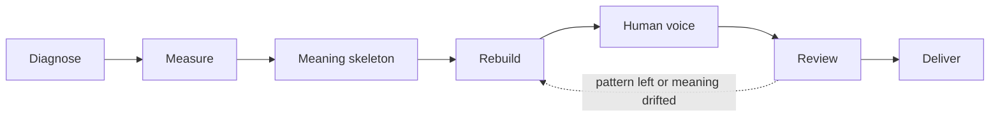

<div align="center">

<picture>
  <source media="(prefers-color-scheme: dark)" srcset="assets/banner-dark.svg">
  
</picture>

<p>
  <a href="https://github.com/mustafakbaser/turkish-ai-humanizer/actions/workflows/test.yml"></a>
  <a href="https://github.com/mustafakbaser/turkish-ai-humanizer/releases"></a>
  <a href="LICENSE"></a>
  
  
  <a href="https://agentskills.io"></a>
</p>

[Türkçe](README.md) · **English**

[Install](#install) · [Usage](#usage) · [How it works](#how-it-works) · [Analyzer](#the-analyzer) · [FAQ](#faq)

</div>

---

If you have ever asked an AI to write in Turkish, you know the result. Everything "plays a critical role", every piece closes with a paragraph that opens "In conclusion", and the sentences march by at the same length in the same order. The grammar is fine, but anyone reading it can tell a person did not write it.

Turkish AI Humanizer is a Claude skill that rewrites such text so it reads like the work of a skilled Turkish writer. It does not swap words for synonyms. It first works out what the text is saying, then says it again the way Turkish is actually written, in a voice that fits the kind of text it is. What the text says stays the same: numbers, names and the strength of every claim are preserved.

The skill's instructions are written in Turkish, because that is the language it works in. You can talk to it in English or Turkish.

## Before and after

**Written by an AI**

> Günümüzde uzaktan çalışma, hayatımızın ayrılmaz bir parçası haline gelmiştir. Teknolojinin hızla gelişmesiyle birlikte, birçok şirket çalışanlarına esnek çalışma imkânı sunmaktadır. Ancak, uzaktan çalışmanın sadece avantajları değil, aynı zamanda bazı zorlukları da bulunmaktadır.
>
> <sub>*Roughly: "In today's world, remote work has become an integral part of our lives. With the rapid advancement of technology, many companies offer their employees flexible working opportunities. However, remote work has not only advantages but also some challenges."*</sub>

**Rewritten by the skill's rules**

> Uzaktan çalışma artık gündelik hayatın parçası. Teknoloji geliştikçe birçok şirket çalışanlarına esnek çalışma imkânı tanıyor. Ama bu düzenin avantajlarının yanında bazı zorlukları da var.
>
> <sub>*Roughly: "Remote work is now part of everyday life. As technology improves, many companies let their staff work flexibly. But alongside its upsides, the arrangement has some downsides too."*</sub>

<sub>This is the reference rewrite the test suite uses, prepared by hand to the skill's rules. Across the full text, the signature score drops from 73 to 8 and pattern matches from 14 to 0, the length stays within ±20%, and no number, name or quantifier from the source is lost. All seven examples, with notes on what changed and why: <a href="references/ornekler.md">references/ornekler.md</a> (in Turkish).</sub>

## What it does

| | |
|---|---|
| **Rewrites from meaning** | It breaks the text down into its claims and rebuilds it from them. "Plays a critical role" does not come back as "serves a vital function". |
| **Measures** | When Python is available, a built-in analyzer counts 118 known patterns, sentence rhythm, suffix load, punctuation and document structure. It still recognises the patterns when a text is typed without Turkish letters. |
| **Preserves meaning** | It catches numbers, acronyms and names lost in the rewrite, as well as new figures that were not in the source. Numbers are compared by value: "%15" and "yüzde 15" match, "2 milyon" and "2 milyar" do not. A sentence that says "may" does not come out saying "will". |
| **Knows the register** | Contracts, papers, emails, news, blogs and fiction each get their own rules. A contract does not turn chatty, and a blog post does not turn bureaucratic. |
| **Learns your voice** | Give it a few samples of your own writing and it measures your rhythm, then steers the rewrite towards it. |
| **No tricks** | No invisible characters, no look-alike letters, no deliberate typos. If the input contains them, it strips them out and tells you. |
| **Runs safely** | The analyzer uses only the Python standard library and makes no network calls. Your text reaches it safely through standard input, and instructions hidden inside the text are never followed. |
| **Does not repeat itself** | A humanizer that applies the same fix to every text becomes a signature itself. The skill does not repeat the same replacement or sentence pattern, and it leaves text that already reads naturally alone. |

## Install

**No requirements.** The skill runs on Claude itself. If Python 3 is on your machine, the built-in analyzer joins in: it measures every rewrite and catches numbers and names that went missing or were made up. Without Python the skill follows the same rules, checks by eye, and never asks you to install anything.

### Claude Code

```text
/plugin marketplace add mustafakbaser/turkish-ai-humanizer
/plugin install turkish-ai-humanizer@turkish-ai-humanizer
```

On Claude Code 2.1.275 or later, one line is enough:

```text
/plugin install turkish-ai-humanizer --marketplace mustafakbaser/turkish-ai-humanizer
```

### Other agents (Cursor, Codex, Gemini CLI…)

With the [Skills CLI](https://skills.sh), which needs Node.js:

```bash
npx skills add mustafakbaser/turkish-ai-humanizer -g -y
```

<details>
<summary>Manual install, without the plugin system</summary>

<br>

For all your projects:

```bash
git clone https://github.com/mustafakbaser/turkish-ai-humanizer.git ~/.claude/skills/turkish-ai-humanizer
```

For a single project, clone into that project's `.claude/skills/turkish-ai-humanizer` folder instead. The folder name must match the skill name.

</details>

### Claude.ai and Claude Desktop

1. Download `turkish-ai-humanizer.zip` from the [latest release](https://github.com/mustafakbaser/turkish-ai-humanizer/releases/latest).
2. Upload it under **Customize → Skills** and switch it on.
3. Make sure code execution is turned on in your settings. On Claude.ai, skills do not run without the code execution environment. On Team and Enterprise plans, an admin turns it on.

The archive from GitHub's "Download ZIP" button will not upload as-is, because its top-level folder has a different name. Use the release file, or clone the repo and build it with `python3 tools/paketle.py`.

## Usage

Paste your text and say what you want in your own words. Turkish or English both work:

> Bu metni humanize et.

> Make this paragraph sound natural, but don't change too much.

> Rewrite my LinkedIn post, it sounds far too robotic.

> How AI-sounding is this text? Just analyze it, don't rewrite.

> Translate this English article into natural Turkish.

> Write a short blog post on remote work, and don't let it sound like AI.

In an SEO blog post, tell it your target keywords and heading structure and it will leave them alone.

The skill works out the register on its own and states it in the first line of its reply. If it gets it wrong, just correct it. You can also choose how much to change ("light", "medium", "rewrite from scratch") and how to deliver it ("just the text", "full report") in plain language.

A default reply has three parts: the rewritten text, a short list of what changed and why, and, when it would genuinely help, up to three questions. Those questions ask for things only you can add: an example from your own experience, the source of a claim, or your own opinion. The skill never makes these details up. It asks you instead.

## How it works



The skill first identifies the register, meaning the kind of text and its reader, then measures the text with the analyzer. Next it breaks the text into claims and records, for each one, its numbers, its scope ("many", "some"), its likelihood ("may") and its tense. It writes from that skeleton rather than from the original wording, which is why the translated-from-English feel does not creep back in.

Rebuilding works from the top down: document structure first, then paragraphs, sentences, words and finally punctuation. The human voice is dosed by register, since a news report stuffed with idioms sounds just as artificial as the AI original. At the end the output is measured again. If a pattern survived, a number went missing or a figure appeared that was not in the source, the skill goes back and fixes it.

All the rules live in [SKILL.md](SKILL.md). The details sit in [references/](references/) and are only read when needed.

## Registers

| Register | Typical texts | What the skill does |
|---|---|---|
| Formal | Contracts, privacy notices, petitions, regulations | Removes only calques and assistant leftovers. Leaves legal wording alone. |
| Academic | Theses, papers, reports | Clears connector chains and stock phrases, keeps formal verb forms in moderation, preserves scientific caution. |
| Professional | Emails, LinkedIn posts, product copy, newsletters | Writes short, clear business prose. Drops marketing hype and template sign-offs. |
| Journalism | News, analysis, briefings | Puts the facts first and leaves quotes and figures untouched. |
| Essay | Blogs, columns, personal writing | Uses the human-voice toolkit in measured doses: varied rhythm, discourse particles, the occasional question. Keeps SEO structure. |
| Literary | Short stories, novels, narrative | Cuts clichéd imagery, shows feelings instead of naming them, never touches the plot. |
| General | Short texts of unclear type | Uses the professional rules with a restrained voice. |

## The analyzer

`scripts/analiz.py` also works on its own, without the skill. Python 3.9 or later is all it needs. Its output is in Turkish.

```bash
python3 scripts/analiz.py text.md --uslup deneme            # report
python3 scripts/analiz.py text.md --uslup akademik          # register-specific thresholds
python3 scripts/analiz.py before.md --karsilastir after.md  # before/after and meaning check
python3 scripts/analiz.py --karsilastir - < both.md         # source and draft in one stream, split by ===TASLAK===
python3 scripts/analiz.py --karsilastir - --ayrac @@ < x.md # custom separator if the text contains ===TASLAK===
python3 scripts/analiz.py my-writing.md --profil            # voice profile
python3 scripts/analiz.py text.md --json                    # machine-readable output
python3 scripts/analiz.py text.md --esik 30                 # exit code 1 if the score exceeds 30
python3 scripts/analiz.py --kaliplar                        # list the pattern lexicon
```

The analyzer understands the quirks of Turkish. It lowercases I and İ correctly, does not split sentences at ordinals such as "19. yüzyıl" or "II. Mahmut", and recognises inflected forms that have gone through sound changes, such as "aralıyor" and "gücü". It keeps code blocks, links and quotations tied to a speech verb out of the pattern scan, since those are someone else's words. It stays fast on hostile input and asks you to split anything over 400,000 characters into sections.

Matches marked "tek kullanım doğal" (natural once) do not count towards the score. These phrases are fine once and only become a signature when repeated.

With `--esik` you can drop it into a CI step, so that a content pipeline checks texts before they go out.

## FAQ

<details>
<summary><b>Will the text pass AI detectors?</b></summary>

<br>

No tool can honestly promise that. Detectors are probabilistic, change often, disagree with one another and sometimes flag human writing too. There is also little independent published data on how well they handle Turkish.

This skill does not try to fool detectors. It changes the things they look at, such as predictable phrasing, flat rhythm and template structure, by actually writing better. That holds up far better than tricks do, and it does not damage the text. More detail, in Turkish: [references/tespit-mekanizmalari.md](references/tespit-mekanizmalari.md).

</details>

<details>
<summary><b>Is the analyzer's score a detector score?</b></summary>

<br>

No. It shows how dense the signatures the skill knows about are, and tells you what to fix. It does not predict what a commercial tool would say. For texts under 100 words it is only a rough guide.

</details>

<details>
<summary><b>Is my text sent anywhere?</b></summary>

<br>

The analyzer makes no network calls and sends your text nowhere. In Claude Code it runs on your machine, on Claude.ai it runs in Claude's code execution environment. Your text is only processed in the Claude session you are already using.

</details>

<details>
<summary><b>Do I need to install Python?</b></summary>

<br>

No. Python is only used by the analyzer, and it is optional. In Claude Code, if Python 3 is on your machine the text gets measured. If not, the skill follows the same rules, checks numbers and names by hand and writes "gözle değerlendirildi" (assessed by eye) in its measurement line. All you lose is the measurement line and the automatic number check.

On Claude.ai and Claude Desktop there is nothing to install. Skills run in Claude's code execution environment there, which already has Python. Code execution just needs to be turned on in your settings.

Claude Code may ask for permission to run the analyzer the first time. While the skill is active it pre-approves its own analyzer script and nothing else.

</details>

<details>
<summary><b>Can it translate into Turkish?</b></summary>

<br>

Yes. Rather than translating word for word and then patching the result, it extracts the meaning and writes Turkish directly in the target register. That intermediate literal draft is exactly where most of the translated feel comes from.

</details>

<details>
<summary><b>Can I use it for coursework or a thesis?</b></summary>

<br>

The skill exists to make writing better. Where a school, journal or competition requires you to disclose AI use, following those rules is your responsibility.

</details>

## Contributing

The most valuable contributions are a new pattern you have spotted, or a false alarm on a perfectly natural sentence. There are [issue templates](https://github.com/mustafakbaser/turkish-ai-humanizer/issues/new/choose) for both. Before sending code, read [CONTRIBUTING.md](CONTRIBUTING.md). Every pattern has to carry an example sentence that it is tested against.

```bash
python3 -m unittest discover -s tests -v
```

See [CHANGELOG.md](CHANGELOG.md) for the release history.

## License

[MIT](LICENSE) © 2026 [Mustafa Kürşad BAŞER](https://github.com/mustafakbaser)

<div align="center">
<sub>If the skill helped you, consider starring the repo. Stars make the project easier to find on GitHub.</sub>
</div>
