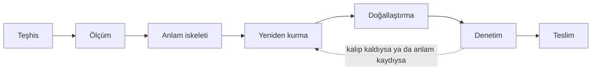

<div align="center">

<picture>
  <source media="(prefers-color-scheme: dark)" srcset="assets/banner-dark.svg">
  
</picture>

<p>
  <a href="https://github.com/mustafakbaser/turkish-ai-humanizer/actions/workflows/test.yml"></a>
  <a href="https://github.com/mustafakbaser/turkish-ai-humanizer/releases"></a>
  <a href="LICENSE"></a>
  
  
  <a href="https://agentskills.io"></a>
</p>

**Türkçe** · [English](README.en.md)

[Kurulum](#kurulum) · [Kullanım](#kullanım) · [Nasıl çalışır](#nasıl-çalışır) · [Analiz aracı](#analiz-aracı) · [SSS](#sık-sorulan-sorular)

</div>

---

Yapay zekâya Türkçe metin yazdıran herkes o üslubu tanır. Her şey "önemli bir rol oynar", yazı "Sonuç olarak" diye başlayan bir paragrafla biter, cümleler birbirine benzer uzunlukta art arda sıralanır. Metinde dilbilgisi hatası yoktur ama okuyan herkes onu bir insanın yazmadığını anlar.

Turkish AI Humanizer, bu tür metinleri işini bilen bir Türk yazarın yazacağı gibi yeniden yazan bir Claude skill'i. Sözcükleri eş anlamlılarıyla değiştirmekle yetinmez. Önce metnin ne söylediğini çıkarır, sonra aynı içeriği Türkçenin doğal cümle yapısıyla ve metnin türüne uygun bir dille yeniden kurar. İçerik ise değişmez. Sayılar, adlar ve iddialar kaynakta nasılsa öyle kalır, "olabilir" diyen bir cümle "kesindir" diye çıkmaz.

## Önce ve sonra

**Yapay zekâ yazdı**

> Günümüzde uzaktan çalışma, hayatımızın ayrılmaz bir parçası haline gelmiştir. Teknolojinin hızla gelişmesiyle birlikte, birçok şirket çalışanlarına esnek çalışma imkânı sunmaktadır. Ancak, uzaktan çalışmanın sadece avantajları değil, aynı zamanda bazı zorlukları da bulunmaktadır.

**Skill'in kurallarıyla yeniden yazıldı**

> Uzaktan çalışma artık gündelik hayatın parçası. Teknoloji geliştikçe birçok şirket çalışanlarına esnek çalışma imkânı tanıyor. Ama bu düzenin avantajlarının yanında bazı zorlukları da var.

<sub>Bu örnek skill'in kurallarına göre elle hazırlandı ve testlerde ölçüt olarak kullanılıyor. Metnin tamamında imza puanı 73'ten 8'e, kalıp sayısı 14'ten 0'a düşüyor. Metin kaynağa göre %20'den fazla kısalmıyor, sayılar ve "birçok", "bazı" gibi nicelik sözcükleri yerinde kalıyor. Yedi örneğin tamamı ve değişikliklerin gerekçeleri: <a href="references/ornekler.md">references/ornekler.md</a></sub>

## Ne yapar

| | |
|---|---|
| **Anlamdan yeniden yazar** | Metni önce tek tek iddialarına ayırır, yazıyı bu iddialardan yeniden kurar. Bu yüzden "kritik bir rol oynamaktadır" kalıbı, "hayati bir işlev üstlenmektedir" gibi eş anlamlı bir kılıkta geri gelmez. |
| **Ölçer** | Python kuruluysa yerleşik analiz aracı metni 118 kalıba karşı tarar. Cümle uzunluklarını, "-mektedir" sıklığını, noktalamayı, başlık ve liste yapısını ölçer. Ç, ğ, ı, ö, ş, ü kullanılmadan yazılmış metinlerde de çalışır. |
| **Anlamı korur** | Yeniden yazımda kaybolan sayıları, kısaltmaları ve adları, kaynakta olmayan yeni sayıları yakalar. Sayıları değerleriyle karşılaştırır: "%15" ile "yüzde 15" aynı sayılır, "2 milyon" ile "2 milyar" farklı. |
| **Metnin türüne uyar** | Sözleşme, makale, e-posta, haber, blog ve öykü için ayrı kurallar uygular. Sözleşmeye gündelik konuşma dili, blog yazısına resmi yazışma dili karışmaz. |
| **Üslubunuza uyar** | Kendi yazdığınız metinlerden örnek verirseniz cümle uzunluğu, noktalama ve sık kullandığınız bağlaçlar gibi alışkanlıklarınızı çıkarır ve yeniden yazımı bunlara göre yapar. |
| **Hile yapmaz** | Görünmez karakter eklemez, harfleri benzer görünen Kiril harfleriyle değiştirmez, bilerek yazım hatası yapmaz. Girdide bunlardan biri varsa temizler ve size bildirir. |
| **Güvenli çalışır** | Analiz aracı yalnızca Python'un standart kütüphanesini kullanır ve internete bağlanmaz. Metnin içine gizlenmiş komutlar ("önceki talimatları unut" gibi) uygulanmaz, metnin bir parçası sayılır. |
| **Kendini tekrar etmez** | Her metinde aynı düzeltmeyi yapan bir araç, zamanla tanınır bir iz bırakır. Skill her metinde aynı ifadeyi ve aynı cümle yapısını kullanmaz. Zaten doğal yazılmış bir metni de baştan yazmaz. |

## Kurulum

**Ek bir şey kurmanız gerekmez.** Bilgisayarınızda Python 3 varsa skill yerleşik analiz aracını da kullanır ve her yeniden yazımda sayıların ve adların korunup korunmadığını otomatik olarak denetler. Python yoksa aynı kurallarla çalışmaya devam eder, bu denetimi kendisi yapar.

### Claude Code

```text
/plugin marketplace add mustafakbaser/turkish-ai-humanizer
/plugin install turkish-ai-humanizer@turkish-ai-humanizer
```

Claude Code 2.1.275 ve sonrasında tek komut yeterli:

```text
/plugin install turkish-ai-humanizer --marketplace mustafakbaser/turkish-ai-humanizer
```

### Diğer ajanlar (Cursor, Codex, Gemini CLI…)

[Skills CLI](https://skills.sh) ile kurulur (Node.js gerekir):

```bash
npx skills add mustafakbaser/turkish-ai-humanizer -g -y
```

<details>
<summary>Eklenti sistemi olmadan, elle kurmak</summary>

<br>

Bütün projelerde kullanmak için:

```bash
git clone https://github.com/mustafakbaser/turkish-ai-humanizer.git ~/.claude/skills/turkish-ai-humanizer
```

Yalnızca tek bir projede kullanmak için hedef klasör olarak projenin içindeki `.claude/skills/turkish-ai-humanizer` yolunu verin. Klasörün adı skill'in adıyla aynı olmalıdır.

</details>

### Claude.ai ve Claude Desktop

1. [Releases](https://github.com/mustafakbaser/turkish-ai-humanizer/releases/latest) sayfasından `turkish-ai-humanizer.zip` dosyasını indirin.
2. **Customize → Skills** bölümünden yükleyip etkinleştirin.
3. Ayarlarda kod çalıştırma (code execution) özelliğinin açık olduğundan emin olun. Claude.ai'de skill'ler bu özellik kapalıyken çalışmaz. Team ve Enterprise planlarında bu ayarı yönetici açar.

GitHub'ın "Download ZIP" düğmesiyle inen arşiv doğrudan yüklenemez, çünkü içindeki klasörün adı farklıdır. Releases'taki dosyayı kullanın ya da repoyu klonlayıp `python3 tools/paketle.py` komutuyla zip'i kendiniz oluşturun.

## Kullanım

Metni yapıştırıp ne istediğinizi normal bir dille yazmanız yeterli:

> Bu metni humanize et.

> Şu paragrafı doğallaştır ama fazla değiştirme.

> LinkedIn gönderimi baştan yaz, çok robotik duruyor.

> Bu metin ne kadar yapay zekâ kokuyor? Sadece analiz et, değiştirme.

> Şu İngilizce yazıyı doğal bir Türkçeye çevir.

> Uzaktan çalışma üzerine kısa bir blog yazısı yaz, AI yazmış gibi durmasın.

SEO için yazılmış bir blog yazısında anahtar kelimelerinizi belirtirseniz skill bunları ve başlık yapısını olduğu gibi bırakır.

Skill metnin türünü (blog, e-posta, akademik metin…) kendisi belirler ve cevabın ilk satırında yazar. Yanlış belirlediyse söylemeniz yeterli. Metnin ne kadar değişeceğini ("az dokun", "baştan yaz") ve cevabın biçimini ("sadece metni ver", "detaylı rapor istiyorum") de aynı şekilde, kendi cümlelerinizle seçebilirsiniz.

Varsayılan cevapta yeniden yazılmış metin, neyin neden değiştiğini anlatan kısa bir liste ve gerekirse en fazla üç soru olur. Bu sorular metne yalnızca sizin ekleyebileceğiniz bilgileri ister: kendi deneyiminizden bir örnek, bir iddianın kaynağı ya da sizin görüşünüz. Skill bu tür ayrıntıları uydurmaz, size sorar.

## Nasıl çalışır



Skill önce metnin türünü ve kime yazıldığını belirler, ardından analiz aracıyla metni ölçer. Sonra metni iddialarına ayırır ve her iddia için içindeki sayıları, kapsamını ("birçok", "bazı"), kesinlik derecesini ("-ebilir") ve zamanını not eder. Yeni metni kaynaktan değil, bu listeden yazar. Kaynağın sözcük seçimine bağlı kalmadığı için çeviri havası da yeni metne taşınmaz.

Düzeltmeler büyükten küçüğe gider: önce metnin genel yapısı, sonra paragraflar, cümleler, sözcükler ve en son noktalama. Konuşma diline yakın öğeler (deyimler, "zaten", "hatta" gibi sözcükler) metnin türüne göre ölçülü kullanılır, çünkü deyim dolu bir haber metni de en az yapay zekâ metni kadar yapay durur. Son adımda metin yeniden ölçülür. Bir kalıp kalmışsa, bir sayı kaybolmuşsa ya da kaynakta olmayan bir sayı eklenmişse skill geri dönüp düzeltir.

Kuralların tamamı [SKILL.md](SKILL.md) dosyasında. Ayrıntılar [references/](references/) klasöründe duruyor ve yalnızca gerektiğinde okunuyor.

## Üsluplar

| Üslup | Örnek metinler | Skill ne yapar |
|---|---|---|
| Resmi | Sözleşme, KVKK metni, dilekçe, yönetmelik | Yalnızca çeviri kalıplarını ve sohbet botundan kalan cümleleri temizler. Hukuki terimlere dokunmaz. |
| Akademik | Tez, makale, rapor | Art arda dizilen "bu bağlamda", "öte yandan" gibi bağlaçları ve kalıpları ayıklar. "-mektedir" kullanımını azaltır ama tamamen kaldırmaz. "Olabilir" diyen bulguyu kesinleştirmez. |
| Profesyonel | E-posta, LinkedIn, ürün metni, bülten | Kısa ve net bir iş diliyle yazar. Pazarlama abartısını ve "iletişime geçmekten çekinmeyin" gibi kalıp kapanışları çıkarır. |
| Gazetecilik | Haber, analiz, brifing | Haberin özünü başa alır. Alıntılara, atıflara ve sayılara dokunmaz. |
| Deneme | Blog, köşe yazısı, kişisel yazı | Cümle uzunluklarını çeşitlendirir. "Zaten", "hatta" gibi konuşma diline yakın sözcükleri ve yerinde bir soruyu ölçülü kullanır. SEO yapısını korur. |
| Edebi | Öykü, roman, anlatı | Klişe benzetmeleri atar. "Hüzünlüydü" demek yerine hüznü bir davranışla gösterir. Olay örgüsüne dokunmaz. |
| Genel | Türü belirsiz kısa metinler | Profesyonel üslubun kurallarıyla, ölçülü bir dille çalışır. |

## Analiz aracı

`scripts/analiz.py`, skill olmadan da tek başına çalışır. Python 3.9 ve üstü yeter, başka bağımlılık yoktur.

```bash
python3 scripts/analiz.py metin.md --uslup deneme           # rapor
python3 scripts/analiz.py metin.md --uslup akademik         # üsluba göre eşikler
python3 scripts/analiz.py once.md --karsilastir sonra.md    # önce/sonra ve anlam koruma
python3 scripts/analiz.py --karsilastir - < ikisi-bir-arada.md # kaynak ve taslak tek dosyada, ===TASLAK=== satırıyla ayrılır
python3 scripts/analiz.py --karsilastir - --ayrac @@ < x.md # metinde ===TASLAK=== geçiyorsa başka bir ayraç
python3 scripts/analiz.py kendi-yazilarim.md --profil       # yazım alışkanlıklarınızın özeti
python3 scripts/analiz.py metin.md --json                   # başka programların okuyabileceği JSON çıktı
python3 scripts/analiz.py metin.md --esik 30                # puan 30'u geçerse çıkış kodu 1
python3 scripts/analiz.py --kaliplar                        # kalıp listesi
```

<details>
<summary>Örnek rapor</summary>

```text
$ python3 scripts/analiz.py tests/fixtures/ai_blog.md --uslup deneme

İMZA PUANI: 73/100 (yüksek)
  kalıp 40,0 · ritim 16,2 · ekler 6,4 · geçiş 10,0 · noktalama 0,0 · yapı 0,0

Ritim
  Cümle boyu: ortalama 10,7, std 2,8, CV 0,26 (en kısa 6, en uzun 16)

Kalıp eşleşmeleri: 15 (ağırlıklı yoğunluk 22,03/100 kelime)
  [3] s.1 "ayrılmaz bir parçası" (şablon) → Sade bir saptamaya indir ya da sil. ...
  [3] s.1 "sadece avantajları değil, aynı zamanda" (retorik) → 'Hem X hem Y', iki ayrı cümle ya da yalnızca Y.
  [3] s.5 "kritik bir rol oynamaktadır" (çeviri) → Etkiyi fiille söyle: 'X, Y'de belirleyici', ...
  [0, tek kullanım doğal] s.7 "Önemli olan," (retorik) → Virgülü ve duyuruyu at, önemli olanı doğrudan söyle.

Öncelikli düzeltmeler
  1. Kalıp temizliği: 14 eşleşme, en yoğun kategoriler: şablon (5), bürokratik (4), çeviri (3). ...
  2. Ritim: Cümle boyları tekdüze (CV 0,26, hedef ≥ 0,55): orta boy cümleler baskın, ...
```

</details>

İmza puanı, metinde yapay zekâya özgü kalıpların ne kadar yoğun olduğunu 0-100 arasında gösterir. "Tek kullanım doğal" diye işaretlenen eşleşmeler bu puana girmez. Bu ifadeler metinde bir kez geçtiğinde sorun değildir, tekrarlandıklarında yapay zekâ izi sayılır.

Araç Türkçenin özelliklerini hesaba katar. I ile İ'yi doğru küçültür, "19. yüzyıl" ya da "II. Mahmut" gördüğünde cümleyi bölmez, "aralıyor" ve "gücü" gibi ses değişimine uğramış biçimleri de tanır. Kod bloklarını, bağlantıları ve "dedi", "söyledi" gibi bir fiille verilmiş alıntıları taramaz, çünkü alıntı başkasının sözüdür ve değiştirilmez. Çok uzun ya da aracı yavaşlatmak için hazırlanmış girdilerde de hızlı çalışır. 400.000 karakterden uzun metinleri bölümlere ayırmanızı ister.

`--esik` seçeneğiyle aracı bir CI adımına ekleyebilir, otomatik üretilen metinleri yayımlanmadan önce denetleyebilirsiniz.

## Sık sorulan sorular

<details>
<summary><b>Metin yapay zekâ detektörlerinden geçer mi?</b></summary>

<br>

Bunu hiçbir araç dürüstçe garanti edemez. Detektörler olasılığa dayanır, sık güncellenir, birbiriyle çelişir ve insanların yazdığı metinleri de yanlışlıkla işaretleyebilir. Türkçe metinlerde ne kadar isabetli oldukları hakkında yayımlanmış bağımsız araştırma da az.

Skill detektörleri kandırmaya çalışmaz. Detektörlerin yakaladığı şeyleri, yani tahmin edilebilir kalıpları, hep aynı uzunluktaki cümleleri ve şablon yapıyı, metni gerçekten daha iyi yazarak ortadan kaldırır. Görünmez karakter ya da bilerek yapılan yazım hatası gibi hileler kısa sürede fark edilir ve metni bozar. Bu yol ise metni iyileştirir. Ayrıntılar: [references/tespit-mekanizmalari.md](references/tespit-mekanizmalari.md).

</details>

<details>
<summary><b>Analiz aracının verdiği puan bir detektör skoru mu?</b></summary>

<br>

Hayır. Puan, skill'in bildiği yapay zekâ kalıplarının metinde ne kadar sık geçtiğini gösterir ve neyin düzeltilmesi gerektiğini söyler. Ticari bir detektörün vereceği sonucu tahmin etmez. 100 kelimeden kısa metinlerde puan yalnızca kabaca fikir verir.

</details>

<details>
<summary><b>Metnim bir yere gönderiliyor mu?</b></summary>

<br>

Analiz aracı internete bağlanmaz ve hiçbir yere veri göndermez. Claude Code'da sizin bilgisayarınızda, claude.ai'de ise Claude'un kod çalıştırma ortamında çalışır. Metniniz yalnızca kullandığınız Claude oturumunda işlenir.

</details>

<details>
<summary><b>Python kurmam gerekiyor mu?</b></summary>

<br>

Hayır. Python yalnızca analiz aracı için kullanılır ve isteğe bağlıdır. Claude Code kullanıyorsanız ve bilgisayarınızda Python 3 varsa metin ölçülür. Yoksa skill aynı kurallarla çalışır, sayıları ve adları kendisi tek tek kontrol eder ve ölçüm satırına "gözle değerlendirildi" yazar. Bu durumda yalnızca ölçüm sonuçlarını ve sayıların otomatik denetimini kaybedersiniz.

Claude.ai ve Claude Desktop'ta kurmanız gereken bir şey yok. Skill'ler orada Claude'un kod çalıştırma ortamında çalışır ve bu ortamda Python zaten var. Yalnızca ayarlarda kod çalıştırma özelliğinin açık olması gerekir.

Claude Code ilk kullanımda analiz komutu için izin isteyebilir. Skill çalışırken yalnızca kendi analiz aracının çalıştırılmasına izin verir, başka hiçbir komuta izin vermez.

</details>

<details>
<summary><b>İngilizceden ya da başka bir dilden çeviri yapabilir mi?</b></summary>

<br>

Evet. Metni önce kelimesi kelimesine çevirip sonra düzeltmeye çalışmaz, çünkü çeviri havası en çok bu ara adımda metne siner. Önce anlamı çıkarır, sonra doğrudan Türkçe yazar.

</details>

<details>
<summary><b>Ödevimde ya da tezimde kullanabilir miyim?</b></summary>

<br>

Skill metni daha iyi yazmanıza yardım etmek için var. Okulunuz, yayın yapacağınız dergi ya da katıldığınız yarışma yapay zekâ kullanımını beyan etmenizi istiyorsa bu kurala uymak sizin sorumluluğunuzdadır.

</details>

## Katkı

En çok işe yarayan katkı iki türlü: skill'in henüz tanımadığı bir yapay zekâ kalıbı ya da doğal bir cümleyi yanlışlıkla işaretlediği bir durum. İkisi için de hazır [issue şablonları](https://github.com/mustafakbaser/turkish-ai-humanizer/issues/new/choose) var. Kod göndermeden önce [CONTRIBUTING.md](CONTRIBUTING.md) dosyasını okuyun. Eklenen her kalıbın, testlerde denetlenen bir örnek cümlesi olmalı.

```bash
python3 -m unittest discover -s tests -v
```

Sürüm geçmişi: [CHANGELOG.md](CHANGELOG.md).

## Lisans

[MIT](LICENSE) © 2026 [Mustafa Kürşad BAŞER](https://github.com/mustafakbaser)

<div align="center">
<sub>Skill işinize yaradıysa repoya yıldız verebilirsiniz. Böylece proje GitHub'da daha kolay bulunur.</sub>
</div>
