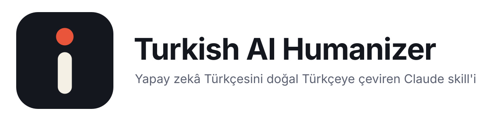
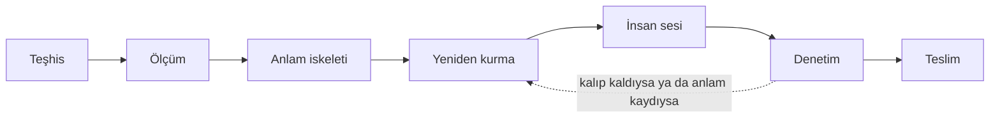

<div align="center">

<picture>
  <source media="(prefers-color-scheme: dark)" srcset="assets/banner-dark.svg">
  
</picture>

<p>
  <a href="https://github.com/mustafakbaser/turkish-ai-humanizer/actions/workflows/test.yml"></a>
  <a href="https://github.com/mustafakbaser/turkish-ai-humanizer/releases"></a>
  <a href="LICENSE"></a>
  
  
  <a href="https://agentskills.io"></a>
</p>

**Türkçe** · [English](README.en.md)

[Kurulum](#kurulum) · [Kullanım](#kullanım) · [Nasıl çalışır](#nasıl-çalışır) · [Analiz aracı](#analiz-aracı) · [SSS](#sık-sorulan-sorular)

</div>

---

Yapay zekâya Türkçe bir metin yazdırdıysanız o tadı tanırsınız. Her şey "önemli bir rol oynuyor", yazılar hep "Sonuç olarak" diye başlayan bir paragrafla bitiyor, cümleler aynı boyda ve aynı sırayla akıp gidiyor. Metin yanlış değil. Ama kimse böyle yazmıyor.

Turkish AI Humanizer, bu metinleri iyi bir Türk yazarın elinden çıkmış gibi yeniden yazan bir Claude skill'i. Sözcükleri eş anlamlılarıyla değiştirip geçmez. Önce metnin ne dediğini çıkarır, sonra aynı şeyi Türkçenin kendi kuruluşuyla ve metnin türüne uygun bir sesle yeniden söyler. Söylenen şey ise değişmez: sayılar, adlar ve iddiaların gücü olduğu gibi kalır.

## Önce ve sonra

**Yapay zekâ yazdı**

> Günümüzde uzaktan çalışma, hayatımızın ayrılmaz bir parçası haline gelmiştir. Teknolojinin hızla gelişmesiyle birlikte, birçok şirket çalışanlarına esnek çalışma imkânı sunmaktadır. Ancak, uzaktan çalışmanın sadece avantajları değil, aynı zamanda bazı zorlukları da bulunmaktadır.

**Skill'in kurallarıyla yeniden yazıldı**

> Uzaktan çalışma artık gündelik hayatın parçası. Teknoloji geliştikçe birçok şirket çalışanlarına esnek çalışma imkânı tanıyor. Ama bu düzenin avantajlarının yanında bazı zorlukları da var.

<sub>Bu, skill'in kurallarına göre hazırlanmış ve testlerde kullanılan başvuru yeniden yazımıdır. Metnin tamamında imza puanı 73'ten 8'e, kalıp sayısı 14'ten 0'a iniyor, uzunluk ±%20 içinde kalıyor ve kaynaktaki hiçbir sayı, ad ya da nicelik kaybolmuyor. Yedi örneğin tamamı ve neyin neden değiştiği: <a href="references/ornekler.md">references/ornekler.md</a></sub>

## Ne yapar

| | |
|---|---|
| **Anlamdan yeniden yazar** | Metni önce iddialarına ayırır, sonra o iddialardan yeniden kurar. "Kritik bir rol oynamaktadır" cümlesi "hayati bir işlev üstlenmektedir" olarak geri dönmez. |
| **Ölçer** | Python varsa yerleşik analiz aracı 118 kalıbı, cümle ritmini, ek yükünü, noktalamayı ve belge yapısını sayar. Türkçe harfler olmadan yazılmış metinde de kalıpları tanır. |
| **Anlamı korur** | Yeniden yazımda kaybolan sayıları, kısaltmaları ve adları, kaynakta olmayan yeni sayıları yakalar. Sayıları değerleriyle karşılaştırır: "%15" ile "yüzde 15" aynıdır, "2 milyon" ile "2 milyar" değildir. "Olabilir" diyen bir cümle "kesindir" diye çıkmaz. |
| **Üslubu tanır** | Sözleşmede, makalede, e-postada, haberde, blogda ve öyküde başka kurallarla çalışır. Sözleşmeye "zaten" girmez, blog yazısı bürokratlaşmaz. |
| **Sesinizi öğrenir** | Kendi yazınızdan örnek verirseniz ritminizi ölçer ve yeniden yazımı ona yaklaştırır. |
| **Hile yapmaz** | Görünmez karakter, harf değişimi ya da kasıtlı yazım hatası kullanmaz. Girdide bunları bulursa temizler ve size söyler. |
| **Güvenli çalışır** | Analiz aracı yalnızca Python standart kütüphanesini kullanır ve ağa bağlanmaz. Metninizi komut satırına güvenli biçimde aktarır, metnin içindeki talimatları uygulamaz. |
| **Kendi izini bırakmaz** | Her metne aynı onarımı uygulayan bir insanlaştırıcı kendisi bir imza olur. Skill aynı yerine koyma sözcüğünü ve aynı cümle kalıbını tekrarlamaz, zaten doğal olan metni yeniden yazmaz. |

## Kurulum

**Gereksinim yok.** Skill Claude'un kendisiyle çalışır. Bilgisayarınızda Python 3 varsa yerleşik analiz aracı da devreye girer: her yeniden yazımı ölçer, kaybolan ya da uydurulan sayıları ve adları yakalar. Python yoksa skill aynı kurallarla çalışır, ölçümü gözle yapar ve sizden hiçbir şey kurmanızı istemez.

### Claude Code

```text
/plugin marketplace add mustafakbaser/turkish-ai-humanizer
/plugin install turkish-ai-humanizer@turkish-ai-humanizer
```

Claude Code 2.1.275 ve sonrasında tek satır yeter:

```text
/plugin install turkish-ai-humanizer --marketplace mustafakbaser/turkish-ai-humanizer
```

### Diğer ajanlar (Cursor, Codex, Gemini CLI…)

[Skills CLI](https://skills.sh) ile, Node.js gerekir:

```bash
npx skills add mustafakbaser/turkish-ai-humanizer -g -y
```

<details>
<summary>Eklenti sistemi olmadan, elle kurmak</summary>

<br>

Bütün projelerde kullanmak için:

```bash
git clone https://github.com/mustafakbaser/turkish-ai-humanizer.git ~/.claude/skills/turkish-ai-humanizer
```

Yalnızca bir projede kullanmak için aynı komutu projenin `.claude/skills/turkish-ai-humanizer` klasörüne çalıştırın. Klasör adı skill adıyla aynı kalmalı.

</details>

### Claude.ai ve Claude Desktop

1. [Releases](https://github.com/mustafakbaser/turkish-ai-humanizer/releases/latest) sayfasından `turkish-ai-humanizer.zip` dosyasını indirin.
2. **Customize → Skills** bölümünden yükleyin ve açın.
3. Ayarlarda kod çalıştırma (code execution) özelliğinin açık olduğundan emin olun. Claude.ai'de skill'ler kod çalıştırma ortamı olmadan çalışmaz. Team ve Enterprise planlarında bu ayarı yöneticiniz açar.

GitHub'ın "Download ZIP" düğmesiyle inen arşiv doğrudan yüklenemez, çünkü içindeki klasörün adı farklıdır. Releases'taki dosyayı kullanın ya da repoyu klonlayıp `python3 tools/paketle.py` ile kendiniz üretin.

## Kullanım

Metni yapıştırın ve ne istediğinizi kendi cümlelerinizle söyleyin:

> Bu metni humanize et.

> Şu paragrafı doğallaştır ama fazla değiştirme.

> LinkedIn gönderimi baştan yaz, çok robotik duruyor.

> Bu metin ne kadar yapay zekâ kokuyor? Sadece analiz et, değiştirme.

> Şu İngilizce yazıyı doğal bir Türkçeye çevir.

> Uzaktan çalışma üzerine kısa bir blog yazısı yaz, AI yazmış gibi durmasın.

SEO için yazılmış bir blogda anahtar kelimelerinizi ve başlık yapınızı söylerseniz bunlara dokunmaz.

Skill metnin türünü kendisi anlar ve cevabın ilk satırında söyler. Yanılırsa düzeltmeniz yeterli. Ne kadar değiştireceğini ("hafif", "orta", "baştan yaz") ve nasıl teslim edeceğini ("sadece metni ver", "detaylı rapor istiyorum") yine doğal dille seçebilirsiniz.

Varsayılan cevapta üç şey bulunur: yeniden yazılmış metin, neyin neden değiştiğini anlatan kısa bir liste ve gerektiğinde en fazla üç soru. Sorular metni gerçekten size ait kılacak şeyi ister: kendi deneyiminizden bir örnek, bir iddianın kaynağı ya da sizin görüşünüz. Hiçbir yeniden yazım, yalnızca sizin bildiğiniz bir ayrıntının yerini tutmaz.

## Nasıl çalışır



Skill önce metnin üslubunu, yani türünü ve okurunu belirler, ardından analiz aracıyla metni ölçer. Sonra metni iddialarına ayırır ve her iddianın sayısını, kapsamını ("birçok", "bazı"), olasılığını ("-ebilir") ve zamanını not eder. Yazımı bu iskeletten yapar. Kaynağın sözcüklerine bağlı kalmadığı için çeviri kokusu da geri gelmez.

Yeniden kurma sırası yukarıdan aşağıya iner: önce belgenin iskeleti, sonra paragraf, cümle, sözcük ve en son noktalama. İnsan sesi üsluba göre dozlanır. Bir haber metnine deyim yağdırmak da en az yapay zekâ kadar yapay durur. En sonda çıktı yeniden ölçülür. Kalıp kalmışsa, bir sayı kaybolmuşsa ya da kaynakta olmayan bir sayı belirmişse skill geri dönüp düzeltir.

Bütün kurallar [SKILL.md](SKILL.md) dosyasında. Ayrıntılar ihtiyaç anında okunan [references/](references/) klasöründe duruyor.

## Üsluplar

| Üslup | Örnek metinler | Skill ne yapar |
|---|---|---|
| Resmi | Sözleşme, KVKK metni, dilekçe, yönetmelik | Yalnızca çeviri kalıplarını ve asistan izlerini temizler. Hukuki sözcüklere dokunmaz. |
| Akademik | Tez, makale, rapor | Geçiş yığınını ve kalıpları atar, "-mektedir"i ölçülü tutar, bilimsel temkini korur. |
| Profesyonel | E-posta, LinkedIn, ürün metni, bülten | Kısa ve net bir iş dili kurar. Pazarlama abartısını ve şablon kapanışları atar. |
| Gazetecilik | Haber, analiz, brifing | Olguyu öne alır, atıfları ve sayıları olduğu gibi bırakır. |
| Deneme | Blog, köşe yazısı, kişisel yazı | İnsan sesinin bütün araçlarını ölçülü kullanır: dalgalı ritim, söylem belirteçleri, yerinde bir soru. SEO yapısını korur. |
| Edebi | Öykü, roman, anlatı | Klişe imgeyi atar, duyguyu bildirmek yerine gösterir, olay örgüsüne dokunmaz. |
| Genel | Türü belirsiz kısa metinler | Profesyonel kurallarla ve ölçülü bir sesle çalışır. |

## Analiz aracı

`scripts/analiz.py`, skill olmadan da tek başına çalışır. Python 3.9 ve üstü yeter, başka bağımlılık yoktur.

```bash
python3 scripts/analiz.py metin.md --uslup deneme           # rapor
python3 scripts/analiz.py metin.md --uslup akademik         # üsluba göre eşikler
python3 scripts/analiz.py once.md --karsilastir sonra.md    # önce/sonra ve anlam koruma
python3 scripts/analiz.py --karsilastir - < ikisi-bir-arada.md # kaynak ve taslak tek akışta, ===TASLAK=== ile ayrılır
python3 scripts/analiz.py --karsilastir - --ayrac @@ < x.md # metin ===TASLAK=== içeriyorsa başka ayraç
python3 scripts/analiz.py kendi-yazilarim.md --profil       # ses kartı
python3 scripts/analiz.py metin.md --json                   # makinenin okuyacağı çıktı
python3 scripts/analiz.py metin.md --esik 30                # puan 30'u geçerse çıkış kodu 1
python3 scripts/analiz.py --kaliplar                        # kalıp sözlüğü
```

<details>
<summary>Örnek rapor</summary>

```text
$ python3 scripts/analiz.py tests/fixtures/ai_blog.md --uslup deneme

İMZA PUANI: 73/100 (yüksek)
  kalıp 40,0 · ritim 16,2 · ekler 6,4 · geçiş 10,0 · noktalama 0,0 · yapı 0,0

Ritim
  Cümle boyu: ortalama 10,7, std 2,8, CV 0,26 (en kısa 6, en uzun 16)

Kalıp eşleşmeleri: 15 (ağırlıklı yoğunluk 22,03/100 kelime)
  [3] s.1 "ayrılmaz bir parçası" (şablon) → Sade bir saptamaya indir ya da sil. ...
  [3] s.1 "sadece avantajları değil, aynı zamanda" (retorik) → 'Hem X hem Y', iki ayrı cümle ya da yalnızca Y.
  [3] s.5 "kritik bir rol oynamaktadır" (çeviri) → Etkiyi fiille söyle: 'X, Y'de belirleyici', ...
  [0, tek kullanım doğal] s.7 "Önemli olan," (retorik) → Virgülü ve duyuruyu at, önemli olanı doğrudan söyle.

Öncelikli düzeltmeler
  1. Kalıp temizliği: 14 eşleşme, en yoğun kategoriler: şablon (5), bürokratik (4), çeviri (3). ...
  2. Ritim: Cümle boyları tekdüze (CV 0,26, hedef ≥ 0,55): orta boy cümleler baskın, ...
```

</details>

"Tek kullanım doğal" diye işaretlenen eşleşmeler puana girmez. Bu ifadeler bir kez geçtiğinde doğaldır, yalnızca tekrar ettiklerinde imza olur.

Araç Türkçenin inceliklerini hesaba katar. I ile İ'yi doğru küçültür, "19. yüzyıl" ya da "II. Mahmut" gördüğünde cümleyi bölmez, "aralıyor" ve "gücü" gibi ses değişimine uğramış biçimleri de tanır. Kod bloklarını, bağlantıları ve bir söyleme fiiline bağlı alıntıları kalıp taramasına sokmaz, çünkü onlar başkasının sözüdür. Kötü niyetle hazırlanmış uzun girdilerde de hızlı kalır ve 400.000 karakterden uzun metni bölümlere ayırmanızı ister.

`--esik` seçeneğiyle aracı bir CI adımına da koyabilirsiniz. Böylece içerik üreten bir sistemde metinler yayımlanmadan önce kontrol edilir.

## Sık sorulan sorular

<details>
<summary><b>Metin yapay zekâ detektörlerinden geçer mi?</b></summary>

<br>

Bunu hiçbir araç dürüstçe garanti edemez. Detektörler olasılığa dayanır, sık güncellenir, birbiriyle çelişir ve insanların yazdığı metinleri de yanlışlıkla işaretleyebilir. Türkçedeki başarıları hakkında yayımlanmış bağımsız veri de az.

Bu skill detektörü kandırmaya uğraşmaz. Detektörlerin baktığı şeyleri, yani öngörülebilir kalıpları, tekdüze ritmi ve şablon yapıyı, metni gerçekten daha iyi yazarak değiştirir. Hilelere göre çok daha dayanıklı bir yol bu ve metni de bozmuyor. Ayrıntı: [references/tespit-mekanizmalari.md](references/tespit-mekanizmalari.md).

</details>

<details>
<summary><b>Analiz aracındaki puan bir detektör skoru mu?</b></summary>

<br>

Hayır. Puan, skill'in tanıdığı imzaların metinde ne kadar yoğun olduğunu gösterir ve neyi düzelteceğinizi söyler. Ticari bir aracın vereceği sonucu tahmin etmez. 100 kelimenin altındaki metinlerde yalnızca yön gösterir.

</details>

<details>
<summary><b>Metnim bir yere gönderiliyor mu?</b></summary>

<br>

Analiz aracı ağa bağlanmaz ve hiçbir yere veri göndermez. Claude Code'da bilgisayarınızda, claude.ai'de ise Claude'un kod çalıştırma ortamında çalışır. Metin yalnızca zaten kullandığınız Claude oturumunda işlenir.

</details>

<details>
<summary><b>Python kurmam gerekiyor mu?</b></summary>

<br>

Hayır. Python yalnızca analiz aracı için kullanılır ve isteğe bağlıdır. Claude Code'da bilgisayarınızda Python 3 varsa ölçüm yapılır. Yoksa skill aynı kurallarla çalışır, sayıları ve adları elle denetler ve ölçüm satırına "gözle değerlendirildi" yazar. Kaybettiğiniz tek şey ölçüm satırı ve sayıların otomatik kontrolüdür.

Claude.ai ve Claude Desktop'ta kurmanız gereken bir şey yok. Skill'ler orada Claude'un kod çalıştırma ortamında çalışır ve o ortamda Python hazırdır. Yalnızca ayarlarda kod çalıştırma özelliğinin açık olması gerekir.

Claude Code ilk kullanımda analiz komutu için izin isteyebilir. Skill etkinken yalnızca kendi analiz betiğine izin tanımlar, başka bir komuta izin vermez.

</details>

<details>
<summary><b>İngilizce ya da başka bir dilden çeviri yapabilir mi?</b></summary>

<br>

Evet. Metni önce birebir çevirip sonra düzeltmeye çalışmaz. Anlamı çıkarır ve doğrudan hedef üslupta Türkçe yazar. Çeviri kokusu en çok o ara adımdan girer.

</details>

<details>
<summary><b>Ödevimde ya da tezimde kullanabilir miyim?</b></summary>

<br>

Skill metni daha iyi yazmak için var. Yapay zekâ kullanımının beyan edilmesini isteyen okul, dergi ya da yarışmalarda o kurallara uymak sizin sorumluluğunuzda.

</details>

## Katkı

En değerli katkı, gözünüze çarpan yeni bir kalıp ya da doğal bir cümlede verilen yanlış bir alarm. İkisi için de hazır [issue şablonları](https://github.com/mustafakbaser/turkish-ai-humanizer/issues/new/choose) var. Kod katkısından önce [CONTRIBUTING.md](CONTRIBUTING.md) dosyasına göz atın. Her kalıbın, kendisini doğrulayan bir örnek cümle taşıması gerekiyor.

```bash
python3 -m unittest discover -s tests -v
```

Değişiklik geçmişi için [CHANGELOG.md](CHANGELOG.md).

## Lisans

[MIT](LICENSE) © 2026 [Mustafa Kürşad BAŞER](https://github.com/mustafakbaser)

<div align="center">
<sub>İşinize yaradıysa repoya bir yıldız verin. Türkçe yazan başkalarının da bulmasını kolaylaştırır.</sub>
</div>
